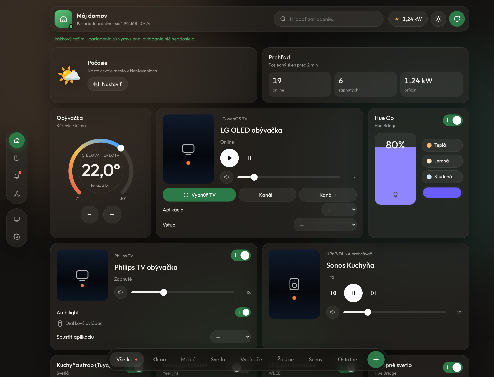

# Moja sieť – dashboard domácej siete (NetDash)

Program preskenuje tvoju domácu sieť, zobrazí **všetky zariadenia** (počítače, mobily, TV, tlačiarne, kamery, router, NAS…) a pri tých, ktoré sa dajú ovládať, pridá **ovládacie prvky** – vypínače, jas, farbu, hlasitosť, diaľkový ovládač, žalúzie atď.

Na beh stačí **Python 3.8+**. Nič ďalšie netreba inštalovať a funguje na Windowse, macOS, Linuxe aj Raspberry Pi.

## Spustenie

| Systém | Ako |
|---|---|
| Windows | dvojklik na `start.bat` (ak chýba Python: [python.org](https://www.python.org/downloads/), pri inštalácii zaškrtni *Add python.exe to PATH*) |
| macOS | dvojklik na `start.command` (prvýkrát: pravý klik → Otvoriť) |
| Linux / Raspberry Pi | `./start.sh` |

Prehliadač sa otvorí sám na `http://localhost:8765`. Prvý sken trvá zhruba 20 – 60 sekúnd.

V okne programu uvidíš adresu a **PIN** na prístup **z mobilu** (napr. `http://192.168.1.10:8765`). Mobil musí byť v tej istej Wi-Fi. Na mobile si stránku môžeš pridať na plochu ako aplikáciu. Na počítači, kde program beží, sa PIN nepýta.



Najprv si môžeš vyskúšať ukážku s vymyslenými zariadeniami:

```bash
python3 netdash.py --demo
```

### Voľby

```
--port 8765        iný port
--local-only       dashboard len pre tento počítač (bez PIN-u, bez prístupu z mobilu)
--pin 1234         vlastný PIN (inak sa vygeneruje a zapamätá)
--subnet 192.168.0.0/24   ktorú sieť skenovať (inak sa zistí automaticky)
--no-scan          nespúšťať sken pri štarte
--no-browser       neotvárať prehliadač
```

## Ako sken funguje

1. **Ping a TCP** sonda na každú adresu v sieti, ďalej ARP tabuľka (nájde aj zariadenia, ktoré na ping neodpovedajú).
2. **SSDP/UPnP, mDNS/Bonjour a NetBIOS** – mená zariadení (napr. „Obývačka TV“, „Janov iPhone“), výrobca a model.
3. **Sken ~40 portov**, z ktorých sa odhadne typ zariadenia a pridajú sa odkazy na jeho webové rozhranie.
4. **Rozpoznanie ovládateľných zariadení**, pri ktorých sa pridá ovládanie.

## Podporované ovládanie

| Zariadenie | Čo sa dá ovládať | Poznámka |
|---|---|---|
| **Shelly** Gen1, Plus/Pro/Gen3 | relé, príkon, svetlá (jas, farba), žalúzie (otvoriť/zavrieť/poloha), teplota | ak má Shelly zapnuté heslo, treba ho vypnúť alebo použiť HA |
| **Tasmota** (Sonoff a i.) | výstupy, stmievač, farba, teplota farby, merania energie a senzory | bez hesla webového rozhrania |
| **WLED** | zap/vyp, jas, farba, efekty, predvoľby | |
| **Philips Hue** | všetky svetlá, miestnosti, jednotlivé svetlá (jas, farba, teplota farby) | raz stlač tlačidlo na moste a klikni *Spárovať* |
| **Yeelight** | zap/vyp, jas, farba, teplota farby | v appke Yeelight zapni *LAN Control* |
| **Sonos** a iné **UPnP/DLNA** prehrávače, TV, receivery | hlasitosť, stlmenie, play/pauza/ďalšia | |
| **LG webOS TV** | hlasitosť, stlmenie, vypnutie, kanály, aplikácie, vstupy HDMI | pri párovaní potvrď na TV |
| **Philips TV** (Android TV aj Saphi) | zapnutie z pohotovosti, vypnutie, hlasitosť, Ambilight, celý ovládač, aplikácie | raz sa spáruje PIN-om z TV; na zapnutie z úplného vypnutia zapni v TV *Zapnúť pomocou Wi-Fi (WoWLAN)* |
| **Samsung Smart TV** (2016+) | celý diaľkový ovládač | pri prvom stlačení potvrď na TV |
| **Roku** | diaľkový ovládač, spúšťanie aplikácií | *Ovládanie mobilnými appkami* musí byť povolené |
| **Home Assistant** | svetlá, vypínače, ventilátory, žalúzie, brány, kúrenie, médiá, zámky, vysávače, scény, skripty | vlož dlhodobý token (Profil → Zabezpečenie) |
| **Akýkoľvek počítač** | **Zobudiť** (Wake-on-LAN) | WoL musí byť zapnutý v BIOS-e/sieťovej karte |

**Tuya, Xiaomi (Mi Home), Zigbee, IKEA a pod.** sa lokálne bez šifrovacích kľúčov ovládať nedajú. Pridaj ich do **Home Assistant** a v dashboarde ich potom ovládaš cez kartu Home Assistant.

**Chromecast, Apple TV a AirPlay** sa zobrazia s menom, ale ich protokoly vyžadujú špeciálne šifrované spojenie, takže ich ovládanie zatiaľ nie je.

## Ďalšie funkcie

- **Premenovanie** zariadení (ikonka ceruzky alebo dvojklik na názov). Meno ostane uložené podľa MAC adresy.
- Štítok **„nové“** pri zariadeniach, ktoré sa v sieti objavili od minulého skenu, a sekcia **Offline**.
- Filtre podľa typu, vyhľadávanie, svetlá/tmavá téma, prispôsobenie pre mobil.
- Stav ovládateľných zariadení sa obnovuje každých 15 s.

## Bezpečnosť

- Prístup z iných zariadení je chránený **PIN-om** (po 5 zlých pokusoch blokovanie na 5 minút) a dashboard má ochranu proti CSRF a DNS rebindingu.
- Prihlásenie z mobilu, tokeny a párovacie kľúče sa ukladajú do `netdash_data.json` vedľa programu. Súbor **nikomu neposielaj**.
- Program komunikuje len so zariadeniami vo tvojej sieti a nič neposiela na internet.
- Skenuj len sieť, ktorá je tvoja.

## Riešenie problémov

- **Nenašlo sa nič / málo zariadení** – firewall (Windows sa pri prvom spustení opýta, povoľ *Súkromné siete*), alebo si pripojený cez VPN. Skús `--subnet 192.168.1.0/24`.
- **Mobil sa nepripojí** – povoľ port 8765 vo firewalle; mobil musí byť v tej istej sieti (nie v sieti pre hostí).
- **Mobily sa objavujú a miznú** – telefóny v spánku neodpovedajú a používajú náhodné (súkromné) MAC adresy.
